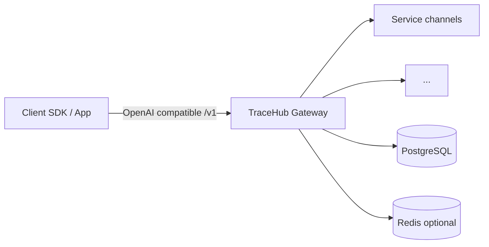

# TraceHub

**English** · [简体中文](README.zh-CN.md)

**TraceHub** is an open-source **AI API gateway / relay**: it aggregates multiple model backends behind a single **OpenAI-compatible API**, with user accounts, API keys, groups & model rate multipliers, usage metering & billing, an admin console, and a marketing site UI.

**Documentation (last reviewed 2026-05-18)**

- **[Documentation index](docs/README.md)** — start here by audience (integrators, self-hosters, sales, developers)
- [Customer onboarding (Chinese)](docs/TraceHub-客户接入宣传.md) · [Customer onboarding (English)](docs/TraceHub-Customer-Onboarding.en.md)
- [Product requirements + implementation status (Chinese)](docs/产品文档.md)
- [Development documentation index](docs/development-docs/README.md)
- [Changelog](CHANGELOG.md) · [Contributing](CONTRIBUTING.md) · [Security](SECURITY.md)

---

## Architecture (overview)



---

## Stack

| Layer | Technologies |
|--------|----------------|
| Backend | Go 1.25+, Gin, [Ent](https://entgo.io/) ORM, PostgreSQL, Redis |
| Frontend | Vue 3, Vite, Tailwind CSS v4, Pinia, Vue Router, Axios |
| Observability | Prometheus `/metrics`, `/health`, `/ready` |

---

## Features (high level)

- **Gateway**: `POST /v1/chat/completions` (SSE streaming; heterogeneous backends normalized to OpenAI-style `chat.completion.chunk` where needed), `GET /v1/models`; optional **passthrough** for additional `/v1/*` paths via `site.openai_passthrough.allow_prefixes` (disabled by default); sensitive cloud-console-style paths under `/v1` are blocked by default (`site.block_openai_account_admin_paths`)
- **Routing**: channels filtered by group & model, weighted random selection; optional Redis sticky sessions
- **Billing**: token estimation & quota deduction; group / user / per-model multipliers
- **Users**: registration & login (JWT), API keys (hashed), balance & usage, redeem codes, password change
- **Admin**: users & channels, groups & model rates, usage logs, batch redeem codes, audit log writes; service credentials stored with AES-GCM
- **Web**: landing (hero / models / pricing / FAQ), user console, admin UI; production build can be served as SPA from the Go binary

### Planned (not in default OSS delivery)

Online payments (Alipay / WeChat / Stripe), OAuth login, full layered rate limits, fine-grained RBAC, content moderation, webhooks, semantic cache, hosted Swagger/OpenAPI UI — see [milestones-roadmap.md](docs/development-docs/milestones-roadmap.md) and the **unfinished** section in [产品文档.md](docs/产品文档.md).

---

## API capability matrix

| Area | Endpoints (summary) | Details |
|------|---------------------|---------|
| Chat | `POST /v1/chat/completions` (SSE), `POST /v1/completions` | [api-design §2.1–2.2](docs/development-docs/api-design.md) · in-app `/docs` |
| Models | `GET /v1/models` | [api-design §2.3](docs/development-docs/api-design.md) |
| Embeddings | `POST /v1/embeddings` | [api-design §2.4](docs/development-docs/api-design.md) |
| Images | `POST /v1/images/generations` | [api-design §2.5](docs/development-docs/api-design.md) |
| Video | `POST/GET/DELETE /v1/videos*` | [api-design §2.6](docs/development-docs/api-design.md) · extended models [§2.8](docs/development-docs/api-design.md) (admin docs) |
| Audio | `POST /v1/audio/speech`, transcriptions, translations | [api-design §2.7](docs/development-docs/api-design.md) |
| Realtime | `POST /v1/realtime/calls` (+ optional call control) | [P3 Realtime design](docs/P3-Realtime通话子资源产品设计.md) |
| Passthrough | Extra `/v1/*` via `site.openai_passthrough` (off by default) | [README features](#features-high-level) · config example |
| Routing headers | `X-TraceHub-Session`, `X-Sticky-Session`, `X-TraceHub-Model` | in-app `/docs` · [api-design §8](docs/development-docs/api-design.md) |

**Migrating from OpenAI-compatible clients:** change `baseURL` and `apiKey` only; expect HTTP `402` when balance is insufficient; streaming responses use a consistent OpenAI-style chunk format.

### Minimal example

```bash
export TRACEHUB_BASE="http://127.0.0.1:8080"
export TRACEHUB_KEY="sk-th-your-key"

curl -sS "$TRACEHUB_BASE/v1/chat/completions" \
  -H "Authorization: Bearer $TRACEHUB_KEY" \
  -H "Content-Type: application/json" \
  -d '{"model":"gpt-4o-mini","messages":[{"role":"user","content":"Hello"}]}'
```

---

## Prerequisites

- Go 1.25+
- Node.js 22+ (local dev / frontend build only)
- PostgreSQL 16+
- Redis 7+ (optional; sticky session features degrade without it)

---

## Quick start

### 1. Configuration

Copy the sample config and edit DSN & secrets:

**Windows (cmd/PowerShell)**

```powershell
copy configs\config.example.yaml configs\config.yaml
```

**Linux / macOS**

```bash
cp configs/config.example.yaml configs/config.yaml
```

Edit `configs/config.yaml`: `database.dsn`, `security.jwt_secret`, and optionally `bootstrap` admin seeding.

### 2. PostgreSQL & Redis

Run services locally or use Docker Compose (below).

### 3. Backend

```bash
go mod download
go run ./cmd/server -config configs/config.yaml
```

Listens on `server.addr` from config (example `:8080`). First run applies Ent migrations and seed data (default group & admin when `bootstrap` is set).

### 4. Frontend (development)

```bash
cd web/frontend
npm install
npm run dev
```

Vite proxies `/api`, `/v1`, etc. to `http://127.0.0.1:8080`.

### 5. Production build (single binary + static)

```bash
make build
```

Or: `npm run build` under `web/frontend`, then `go build -o bin/tracehub ./cmd/server`. If `web/frontend/dist` exists, the server serves static assets and SPA fallback routes.

---

## Docker Compose (all-in-one local stack)

```bash
docker compose -f deploy/docker-compose.local.yml up --build
```

Mounts `configs/config.docker.yaml` as `/app/config.yaml` in the app container. **Change default passwords and `jwt_secret` before production.**

---

## Makefile shortcuts

| Target | Description |
|--------|-------------|
| `make run` | Run backend with `configs/config.yaml` |
| `make fe` | Dev server for the frontend |
| `make build` | Build frontend + compile backend to `bin/tracehub` |
| `make ent` | Regenerate Ent code from `internal/ent/schema` |
| `make docker-up` | Build & start the Compose stack |

---

## Repository layout (partial)

```text
cmd/server/          # Application entrypoint
internal/ent/      # Ent schemas & generated code
internal/gateway/    # Router selection & relay adapters
internal/handler/    # HTTP handlers (user / admin / gateway)
internal/server/     # Gin router & optional SPA hosting
web/frontend/        # Vue 3 SPA
configs/             # Sample & Docker-oriented configs
docs/                # Product & engineering docs
deploy/              # Compose & deployment descriptors
```

---

## License

[MIT License](LICENSE).

---

## Contributing

See [CONTRIBUTING.md](CONTRIBUTING.md). PRs should use [.github/pull_request_template.md](.github/pull_request_template.md).
