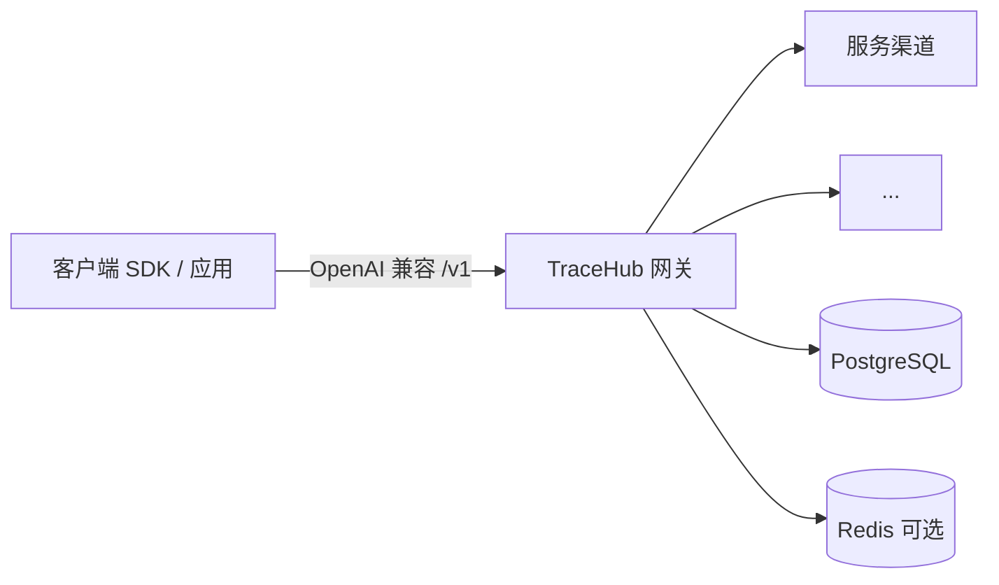

# TraceHub

**简体中文** · [English README](README.md)

**TraceHub** 是一套开源的 **AI API 网关 / 中转站**：将多种大模型服务以 **OpenAI 兼容接口** 对外统一暴露，并提供用户体系、API Key、分组与模型倍率、用量与计费、管理后台与官网前端。

> GitHub 仓库首页默认展示英文说明：[README.md](README.md)。

**文档（核对日期 2026-05-18）**

- **[文档索引](docs/README.md)** — 按角色选择入口（接入 / 自托管 / 售前 / 开发）
- [客户接入宣传](docs/TraceHub-客户接入宣传.md) · [Customer onboarding (EN)](docs/TraceHub-Customer-Onboarding.en.md)
- [产品需求文档 + 实现状态](docs/产品文档.md)
- [开发文档索引](docs/development-docs/README.md)
- [CHANGELOG](CHANGELOG.md) · [贡献指南](CONTRIBUTING.md) · [安全策略](SECURITY.md)

---

## 架构概览



---

## 技术栈

| 层级 | 技术 |
|------|------|
| 后端 | Go 1.25+、Gin、[Ent](https://entgo.io/) ORM、PostgreSQL、Redis |
| 前端 | Vue 3、Vite、Tailwind CSS v4、Pinia、Vue Router、Axios |
| 观测 | Prometheus `/metrics`、健康检查 `/health`、`/ready` |

---

## 已实现能力（概要）

- 网关：`POST /v1/chat/completions`（OpenAI 兼容、含 SSE；多线路流式统一为 OpenAI 风格 `chat.completion.chunk`）、`GET /v1/models`；可选按白名单透传更多 `/v1/*`（`site.openai_passthrough`，默认关闭）；默认拦截 `/v1` 下组织/账单等控制台类路径（`site.block_openai_account_admin_paths`）
- 路由：按分组与模型筛选渠道，加权随机；Redis 可选粘性会话
- 计费：Token 估算与额度扣减；分组 / 用户 / 模型倍率参与计价
- 用户：注册登录 JWT、API Key（哈希存储）、余额与用量、兑换码、修改密码
- 管理端：用户与渠道、分组与模型倍率、调用日志、兑换码批量生成、审计日志写入；渠道凭据 AES-GCM 加密存储
- 前端：官网（Hero / 模型 / 价格 / FAQ）、用户控制台、管理后台；构建产物可由后端托管 SPA

### 规划能力（默认开源包未交付）

在线支付（支付宝/微信/Stripe）、OAuth 登录、完整多层限流、细粒度 RBAC、内容安全过滤、Webhook、语义缓存、托管 Swagger/OpenAPI — 见 [里程碑与路线图](docs/development-docs/milestones-roadmap.md) 与 [产品文档](docs/产品文档.md) 第九章「未完成项」。

---

## API 能力矩阵

| 类别 | 端点（摘要） | 说明 |
|------|-------------|------|
| 对话 | `POST /v1/chat/completions`（SSE）、`POST /v1/completions` | [api-design §2.1–2.2](docs/development-docs/api-design.md) · 站内 `/docs` |
| 模型列表 | `GET /v1/models` | [api-design §2.3](docs/development-docs/api-design.md) |
| 向量 | `POST /v1/embeddings` | [api-design §2.4](docs/development-docs/api-design.md) |
| 图像 | `POST /v1/images/generations` | [api-design §2.5](docs/development-docs/api-design.md) |
| 视频 | `POST/GET/DELETE /v1/videos*` | [api-design §2.6](docs/development-docs/api-design.md) · 扩展模型 [§2.8](docs/development-docs/api-design.md)（管理/自建文档） |
| 音频 | `POST /v1/audio/speech`、转写、翻译 | [api-design §2.7](docs/development-docs/api-design.md) |
| Realtime | `POST /v1/realtime/calls`（及可选通话控制） | [P3 Realtime 设计](docs/P3-Realtime通话子资源产品设计.md) |
| 透传 | `site.openai_passthrough` 白名单扩展 `/v1/*`（默认关） | 配置示例 `configs/config.example.yaml` |
| 选路头 | `X-TraceHub-Session`、`X-Sticky-Session`、`X-TraceHub-Model` | 站内 `/docs` · [api-design §8](docs/development-docs/api-design.md) |

**从 OpenAI 兼容客户端迁移：** 仅需替换 `baseURL` 与 `apiKey`；余额不足可能返回 HTTP `402`；流式输出统一为 OpenAI 风格 `chat.completion.chunk`。

### 最小 cURL 示例

```bash
export TRACEHUB_BASE="http://127.0.0.1:8080"
export TRACEHUB_KEY="sk-th-your-key"

curl -sS "$TRACEHUB_BASE/v1/chat/completions" \
  -H "Authorization: Bearer $TRACEHUB_KEY" \
  -H "Content-Type: application/json" \
  -d '{"model":"gpt-4o-mini","messages":[{"role":"user","content":"你好"}]}'
```

---

## 环境要求

- Go 1.25+
- Node.js 22+（仅本地开发 / 构建前端）
- PostgreSQL 16+
- Redis 7+（可选；不连接时粘性会话等能力降级）

---

## 快速开始

### 1. 配置

复制示例配置并按环境修改数据库与密钥：

**Windows**

```powershell
copy configs\config.example.yaml configs\config.yaml
```

**Linux / macOS**

```bash
cp configs/config.example.yaml configs/config.yaml
```

编辑 `configs/config.yaml` 中的 `database.dsn`、`security.jwt_secret`，以及可选的 `bootstrap` 种子管理员账号。

### 2. 启动数据库与 Redis

本地自行启动服务，或使用 Docker Compose（见下文）。

### 3. 启动后端

```bash
go mod download
go run ./cmd/server -config configs/config.yaml
```

默认监听配置中的 `server.addr`（示例为 `:8080`）。首次启动会执行 Ent 迁移并写入种子数据（默认分组与管理员，若配置了 `bootstrap`）。

### 4. 启动前端（开发）

```bash
cd web/frontend
npm install
npm run dev
```

Vite 已将 `/api`、`/v1` 等代理到 `http://127.0.0.1:8080`，前端页面可直接联调后端。

### 5. 生产构建（单体托管）

```bash
make build
```

或分步：先在 `web/frontend` 执行 `npm run build`，再 `go build -o bin/tracehub ./cmd/server`。若存在 `web/frontend/dist`，进程会自动托管静态资源与 SPA 路由。

---

## Docker Compose（本地一体化）

```bash
docker compose -f deploy/docker-compose.local.yml up --build
```

使用 `configs/config.docker.yaml` 挂载为容器内 `/app/config.yaml`。生产环境请务必替换默认口令与 `jwt_secret`。

---

## 常用命令（Makefile）

| 命令 | 说明 |
|------|------|
| `make run` | 使用 `configs/config.yaml` 运行后端 |
| `make fe` | 启动前端开发服务器 |
| `make build` | 构建前端 + 编译后端到 `bin/tracehub` |
| `make ent` | 根据 `internal/ent/schema` 重新生成 Ent 代码 |
| `make docker-up` | 构建并启动 Compose 栈 |

---

## 仓库结构（节选）

```text
cmd/server/          # 程序入口
internal/ent/      # Ent 数据模型与生成代码
internal/gateway/    # 路由选择、Relay 适配
internal/handler/    # HTTP 处理器（用户 / 管理 / 网关）
internal/server/     # Gin 路由与 SPA 托管
web/frontend/        # Vue 3 前端
configs/             # 配置示例与 Docker 配置
docs/                # 产品与开发文档
deploy/              # Compose 等部署描述
```

---

## 许可证

本项目采用 [MIT License](LICENSE)。

---

## 贡献

详见 [CONTRIBUTING.md](CONTRIBUTING.md)。PR 请使用 [.github/pull_request_template.md](.github/pull_request_template.md) 自检项。
