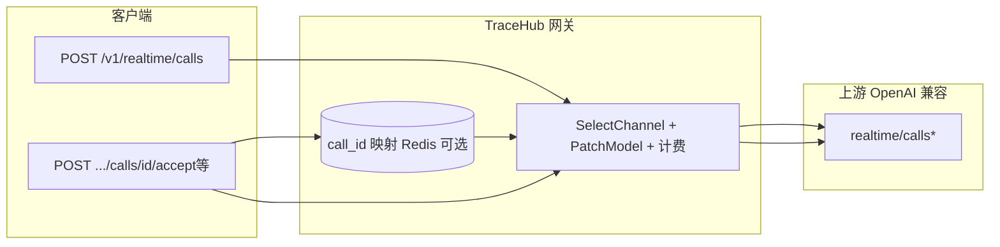

# P3：Realtime 通话子资源 — 产品设计文档

**文档版本**：1.0  
**日期**：2026-05-11  
**关联清单**：[OpenAI接口兼容待实现清单.md](./OpenAI接口兼容待实现清单.md) 第二节 P3 / 序号 11  
**状态**：产品设计（实现前评审）

---

## 1. 背景与问题陈述

### 1.1 官方能力

OpenAI Realtime 在 **SIP 入呼 / 通话生命周期** 场景下，除已实现的 `POST /v1/realtime/calls`（WebRTC SDP 交换）外，还提供基于 `call_id` 的 **通话控制子资源**（均为 `POST`，JSON 或空体）：

| 路径 | 用途 | 请求体要点 |
|------|------|------------|
| `POST /v1/realtime/calls/{call_id}/accept` | 接听入呼并配置 Realtime 会话 | 必填 `type: "realtime"`；可选 `model`、`instructions`、`audio`、`tools` 等与会话相关的字段 |
| `POST /v1/realtime/calls/{call_id}/reject` | 拒接，向主叫返回 SIP 状态码 | 可选 `status_code`（默认 `603` Decline） |
| `POST /v1/realtime/calls/{call_id}/hangup` | 结束当前通话（SIP 或 WebRTC） | 通常无 body，仅路径参数 |
| `POST /v1/realtime/calls/{call_id}/refer` | SIP REFER 转接 | 必填 `target_uri`（如 `tel:+1...` 或 `sip:...`） |

官方参考：[Calls 子资源](https://developers.openai.com/api/reference/resources/realtime/subresources/calls/)。

### 1.2 TraceHub 现状

- 已实现 `POST /v1/realtime/calls`：从 **multipart 中的 `session` JSON** 或 **Query `model=`** 解析模型，走 `SelectChannel`、计费、`PatchModelInBody` 后透传上游（见 `internal/handler/gateway/realtime_calls.go`）。
- **子资源请求路径仅含 `call_id`**，请求体中 **不一定** 再次携带 `model`。网关若不做额外设计，**无法仅凭 `call_id` 推断应转发到哪条渠道 / 哪个上游 API Key**，这是 P3 的核心产品与技术交叉点。

### 1.3 本阶段目标

在保持 **OpenAI 兼容形态**（路径、方法、鉴权头、错误 envelope 尽量一致）的前提下，为上述子资源定义 **可落地的选路、安全、计费与观测** 方案，并给出 **验收标准** 与 **非目标**，供研发排期实现。

---

## 2. 用户与场景

| 角色 | 场景 | 典型调用 |
|------|------|----------|
| 后端（Webhook 处理器） | 收到 OpenAI「来电」类事件，拿到 `call_id`，决定接听并下发会话配置 | `.../accept` + JSON |
| 同一后端 | 拒接骚扰或占线 | `.../reject` |
| 运维 / 应用逻辑 | 主动挂断 | `.../hangup` |
| 呼叫中心集成 | 将 SIP 会话转给外线或坐席 | `.../refer` |

**说明**：`accept` / `reject` 与 **SIP 入呼** 强相关；`hangup` 同时适用于 **WebRTC 与 SIP**。若产品仅面向「纯 WebRTC、无 SIP」，仍建议实现 `hangup` 以贴近官方 SDK 行为，其余可按「是否开通 SIP」做功能开关。

---

## 3. 产品原则

1. **默认兼容**：路径、HTTP 方法、成功/失败语义与官方一致；TraceHub 扩展一律 **可选**，避免破坏裸替官方域名的客户端。
2. **选路可解释**：任意一次子资源调用，在网关内部都能明确落到 **唯一**（或在策略允许下的）渠道与上游模型别名。
3. **最小权限**：同一用户的 `call_id` **不得**被其他租户通过猜测 ID 劫持；需结合 **API Key 维度** 校验。
4. **计费可审计**：与现有 Realtime / 音频类接口一致，能关联 `request_id`、用户、Key、渠道、逻辑模型与扣费记录。

---

## 4. 核心设计：call_id → 渠道 / 模型

### 4.1 问题归纳

子资源 URI **不含** `model`，上游 OpenAI 侧 `call_id` 由 **创建该通话时所使用的上游凭证** 限定。网关代转发时，必须使用 **与同一次通话创建时相同的渠道凭据** 调用子资源，否则上游会 404 / 403。

因此产品必须在以下两类策略中做出选择或组合（**推荐组合策略**）。

### 4.2 策略 A — 显式传模型（零状态、实现快）

**规则**：若请求 **未命中** 策略 B 的映射，则子资源 **必须** 能通过以下之一解析出 **逻辑模型名**（与现有网关一致，用于 `SelectChannel`）：

- Query：`?model=gpt-realtime`（或分组内别名）
- Header：`X-TraceHub-Model`（若项目已有统一头，与之对齐）
- Body（仅 `accept` 适用）：官方已支持 body 内 `model` 字段，**解析 body 中的 `model` 作为优先或兜底**（与 `POST /v1/realtime/calls` 的 session 行为对齐）

**优点**：无需 Redis/DB 存映射，无 TTL 治理。  
**缺点**：客户端必须在每次子资源调用携带模型信息；与「仅传 call_id」的极简脚本略有摩擦。

### 4.3 策略 B — 网关侧映射（体验贴近官方）

**规则**：在 **成功创建通话或收到可关联事件** 时，由网关（或同步的 Webhook 边缘）写入短期映射：

`{api_key_id 或 租户作用域} + call_id → {channel_id, upstream_model, logical_model, optional: sticky}`  

建议存储：**Redis**，TTL **与通话合理上限一致**（产品可配置，默认如 24h 或 4h，需调研上游 call 生命周期）。

**写入时机（产品可选其一或组合）**：

1. **强一致（推荐若可控）**：在 TraceHub 已代理的「创建会话 / 领取 call_id」链路中写入（例如未来若对 `client_secrets` 或 SIP webhook 统一经网关登记 `call_id`）。
2. **弱一致**：提供 **管理或内部 API**（非 OpenAI 路径）供业务在从 OpenAI 收到 `call_id` 后 **主动登记**「此 call_id 属于某模型/某 sticky」；仅适合自建集成，不适合纯裸替。

**读取规则**：子资源到达时 **先查映射**；命中则 **忽略** Query 中的 model（或仅以 model 做校验：若与映射不一致则 400，防配错）。

**优点**：客户端可只带 `call_id`，体验接近直连 OpenAI。  
**缺点**：需 TTL、多实例一致性、密钥轮换与映射失效时的降级文案。

### 4.4 推荐组合（产品默认）

| 优先级 | 行为 |
|--------|------|
| 1 | 若 Redis 映射命中 → 使用该 `channel_id` / 模型，**不再要求** Query model。 |
| 2 | 未命中 → **要求** `model`（Query / Header 或 `accept` body 内），行为与当前 `realtime/calls` 一致。 |
| 3 | 均未满足 → **400** `invalid_request_error`，明确文案：需 `model` 或先建立 call 映射。 |

配置项建议：`realtime_call_mapping_enabled`（bool）、`realtime_call_mapping_ttl_sec`（int）。

---

## 5. 安全与多租户

1. **作用域键**：映射键必须包含 **API Key 标识**（或等价租户隔离字段），避免跨 Key 碰撞。
2. **只读子资源**：`hangup` / `reject` 等若 body 为空，**完全依赖** 策略 A 或 B；禁止将 `call_id` 仅与 User ID 绑定而不带 Key，否则同一用户多 Key 会错乱。
3. **透传头**：与现有 Realtime 一致，仅白名单透传必要头（如 `OpenAI-Beta` 等若适用），避免凭子资源注入异常头绕过审计。

---

## 6. 计费与配额（产品规则）

| 接口 | 建议计费策略 |
|------|----------------|
| `accept` | 与一次「会话配置变更」相当：可按 **请求次数** 收固定点，或按 body 估算 token + 后续用量以官方响应为准补扣（与 `realtime/calls` 同引擎逻辑对齐）。 |
| `reject` / `hangup` | 按 **低单价按次** 或 **不计费**（配置项）；需在控制台说明避免争议。 |
| `refer` | 按次 + 可选「转接成功」不二次计费（由运营定）。 |

**原则**：预估扣费 + 上游成功后再按 usage 修正的路径与现有网关保持一致；若上游无 usage 字段，则回退到预估逻辑。

---

## 7. 渠道与错误处理

1. **渠道类型**：与现网一致，Realtime 相关仅放行 **`openai` / `deepseek`**（或可配置扩展）；不支持的类型返回 **400**，文案与 `realtime_calls` 一致风格。
2. **上游错误**：原样透传 HTTP 状态与 body（与现有多数 OpenAI 代理一致），便于客户端按官方码处理。
3. **映射过期**：返回 **404** 或 **400**（产品定一种并写死文档）：建议 **400** + 明确「映射已过期，请携带 model 重试」，避免与上游「call 不存在」混淆时可加内部 trace id。

---

## 8. 与现有能力的关系

- **不改变** 已有 `POST /v1/realtime/calls` 契约。  
- 若启用映射，可选地在 **该路径成功返回后** 从响应体解析 `call_id`（若官方返回）并写入映射 — 需在技术方案中确认响应结构；若当前响应无 `call_id`，则映射写入依赖 SIP Webhook 集成或策略 A。

---

## 9. 验收标准（建议）

1. **路由注册**：`POST /v1/realtime/calls/:call_id/accept|reject|hangup|refer` 注册且经 `GatewayAPIKeyAuth`。
2. **选路**：在「仅 model Query」与「仅映射」两种配置下各至少一条集成用例通过。
3. **鉴权隔离**：Key A 写入的映射 Key B **不可**用。
4. **计费**：accept 至少产生可追溯流水；hangup/reject 行为符合控制台配置说明。
5. **openaicompat**：`NormalizeOpenAIAPIRoot` 与文档中 [待实现清单](./OpenAI接口兼容待实现清单.md) 第五节一致，补充误粘贴后缀规则（若新增 base 形态）。
6. **文档**：README / 控制台「支持路径」列表更新。

---

## 10. 非目标（本阶段不做或另立项）

- 不在网关内实现 **完整 SIP/PSTN 接入**（仅 HTTP 子资源代理）。  
- 不承诺 **非 OpenAI 上游** 对 `refer` / SIP 状态码的语义一致（若 deepseek 等未实现，应 **明确 501 或 400**）。  
- 不提供「任意 OpenAI 账号的 call_id 代操作」而无映射、无 model 的 **纯盲转发**（安全与计费不可控）。

---

## 11. 配置与可观测性

- **配置**：TTL、是否启用映射、reject/hangup 是否计费。  
- **日志**：`call_id`、`channel_id`、逻辑 `model`、是否命中映射、上游 `status`。  
- **指标**：与现网 `GatewayRequests` 维度对齐，增加 `handler=realtime_call_accept` 等 label（实现阶段细化）。

---

## 12. 开放问题（需产品 / 业务确认）

1. 是否 **默认启用** 策略 B，还是首版仅 **策略 A** 降低复杂度？  
2. `refer` 是否在首版一并交付，还是二期（依赖 SIP 客户比例）？  
3. 映射写入的 **权威来源**（仅网关创建 vs Webhook 登记）以哪条业务线为准？

---

## 13. 修订记录

| 日期 | 版本 | 说明 |
|------|------|------|
| 2026-05-11 | 1.0 | 初版：基于待实现清单 P3 与 OpenAI Calls 子资源官方说明整理 |
